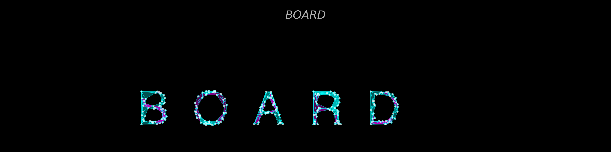
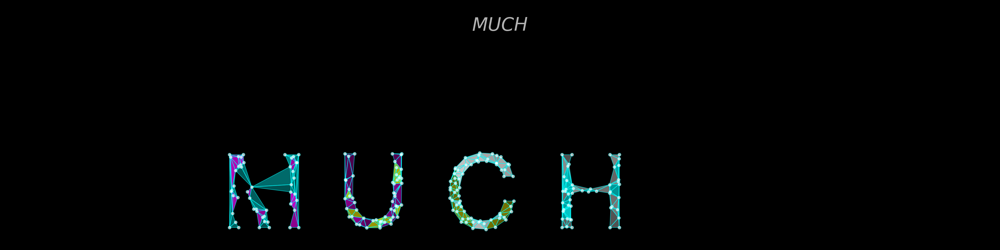

Examples Showcase
=================

.. note::

   This page is generated by ``docs/generate_examples.py``. Every image below
   is rendered from the code shown next to it on each documentation build, so
   the pictures always match the current release. Edit the script, not this
   file.

All examples assume:

.. code-block:: python

   from meshedlogo import MeshedLogo

Gallery
-------

**BOARD** - Multi-character logo with gradient colors from cyan to magenta, showing the mesh structure and vertices.

**MUCH** - Another multi-character example demonstrating mesh generation for various letter shapes including characters with holes.

Rendering Styles
----------------

Default
~~~~~~~

Surface, wireframe and vertices all enabled - the default look.

.. code-block:: python

   logo = MeshedLogo()
   logo.generate("MESH", output_file="default.png")

.. image:: _static/images/examples/default.png
   :alt: Default
   :align: center
   :width: 600px

Surface Only
~~~~~~~~~~~~

Display only the filled triangles without wireframe or vertices.

.. code-block:: python

   logo = MeshedLogo()
   logo.generate(
       "TEXT",
       output_file="surface_only.png",
       show_wireframe=False,
       show_vertices=False,
       colors=['cyan', 'magenta']
   )

.. image:: _static/images/examples/surface_only.png
   :alt: Surface Only
   :align: center
   :width: 600px

Wireframe Only
~~~~~~~~~~~~~~

Display only the mesh lines without surface or vertices.

.. code-block:: python

   logo = MeshedLogo()
   logo.generate(
       "MESH",
       output_file="wireframe_only.png",
       show_surface=False,
       show_vertices=False,
       wireframe_thickness=1.0,
       colors=['cyan']
   )

.. image:: _static/images/examples/wireframe_only.png
   :alt: Wireframe Only
   :align: center
   :width: 600px

Vertices Only
~~~~~~~~~~~~~

Display only the vertex points.

.. code-block:: python

   logo = MeshedLogo()
   logo.generate(
       "DOTS",
       output_file="vertices_only.png",
       show_surface=False,
       show_wireframe=False,
       vertex_size=15.0,
       colors=['cyan']
   )

.. image:: _static/images/examples/vertices_only.png
   :alt: Vertices Only
   :align: center
   :width: 600px

Thick Wireframe
~~~~~~~~~~~~~~~

Surface with a thick wireframe.

.. code-block:: python

   logo = MeshedLogo()
   logo.generate(
       "TEXT",
       output_file="combined.png",
       show_surface=True,
       show_wireframe=True,
       wireframe_thickness=2.0,
       colors=['cyan', 'magenta', 'yellow']
   )

.. image:: _static/images/examples/combined.png
   :alt: Thick Wireframe
   :align: center
   :width: 600px

Invert Mode
~~~~~~~~~~~

Mesh the background instead of the character: the text becomes a hole in the meshed background, creating a negative space effect.

.. code-block:: python

   logo = MeshedLogo()
   logo.generate(
       "TEXT",
       output_file="inverted.png",
       invert_mode=True,
       invert_margin=50,
       colors=['cyan', 'magenta']
   )

.. image:: _static/images/examples/inverted.png
   :alt: Invert Mode
   :align: center
   :width: 600px

Random Vertices
~~~~~~~~~~~~~~~

Display 50% of the vertices, randomly selected.

.. code-block:: python

   logo = MeshedLogo()
   logo.generate(
       "TEXT",
       output_file="random_vertices.png",
       vertex_mode='random',
       vertex_size=12.0,
       colors=['cyan', 'magenta']
   )

.. image:: _static/images/examples/random_vertices.png
   :alt: Random Vertices
   :align: center
   :width: 600px

Multi-Component Logos
---------------------

Side by Side
~~~~~~~~~~~~

Two components with independent colors placed on one canvas.

.. code-block:: python

   logo = MeshedLogo(canvas_size=(2400, 700))

   components = [
       {
           'text': 'MESHED',
           'position': (100, 400),
           'scale': 2.0,
           'colors': ['cyan', 'magenta']
       },
       {
           'text': 'LOGO',
           'position': (1600, 400),
           'scale': 2.0,
           'colors': ['yellow', 'white']
       }
   ]

   logo.generate_multi(components, output_file="side_by_side.png")

.. image:: _static/images/examples/side_by_side.png
   :alt: Side by Side
   :align: center
   :width: 600px

Stacked
~~~~~~~

Components stacked vertically. The y axis grows downwards, so a smaller y places a component higher on the canvas.

.. code-block:: python

   logo = MeshedLogo(canvas_size=(1000, 1000))

   components = [
       {
           'text': 'TOP',
           'position': (300, 300),
           'scale': 2.0,
           'colors': ['cyan', 'magenta']
       },
       {
           'text': 'BOTTOM',
           'position': (200, 700),
           'scale': 2.0,
           'colors': ['yellow', 'white']
       }
   ]

   logo.generate_multi(components, output_file="stacked.png")

.. image:: _static/images/examples/stacked.png
   :alt: Stacked
   :align: center
   :width: 600px

Color Schemes
-------------

Monochrome
~~~~~~~~~~

A single color.

.. code-block:: python

   logo = MeshedLogo()
   logo.generate("TEXT", output_file="mono.png", colors=['white'])

.. image:: _static/images/examples/mono.png
   :alt: Monochrome
   :align: center
   :width: 600px

Dual Color
~~~~~~~~~~

A two-color gradient, applied left to right across the text bounds.

.. code-block:: python

   logo = MeshedLogo()
   logo.generate("TEXT", output_file="dual.png", colors=['cyan', 'magenta'])

.. image:: _static/images/examples/dual.png
   :alt: Dual Color
   :align: center
   :width: 600px

Multi Color
~~~~~~~~~~~

Any number of colors can be used in the gradient.

.. code-block:: python

   logo = MeshedLogo()
   logo.generate("TEXT", output_file="multi_color.png",
                 colors=['cyan', 'magenta', 'yellow', 'white'])

.. image:: _static/images/examples/multi_color.png
   :alt: Multi Color
   :align: center
   :width: 600px

Mesh Density
------------

Low Density (Coarse Mesh)
~~~~~~~~~~~~~~~~~~~~~~~~~

About 25 interior points for a sparser, more geometric look.

.. code-block:: python

   logo = MeshedLogo()
   logo.generate("TEXT", output_file="density_low.png", mesh_density=0.5)

.. image:: _static/images/examples/density_low.png
   :alt: Low Density (Coarse Mesh)
   :align: center
   :width: 600px

Default Density
~~~~~~~~~~~~~~~

About 75 interior points - balanced between detail and simplicity.

.. code-block:: python

   logo = MeshedLogo()
   logo.generate("TEXT", output_file="density_default.png", mesh_density=1.5)

.. image:: _static/images/examples/density_default.png
   :alt: Default Density
   :align: center
   :width: 600px

High Density (Fine Mesh)
~~~~~~~~~~~~~~~~~~~~~~~~

About 150 interior points for a more detailed mesh.

.. code-block:: python

   logo = MeshedLogo()
   logo.generate("TEXT", output_file="density_high.png", mesh_density=3.0)

.. image:: _static/images/examples/density_high.png
   :alt: High Density (Fine Mesh)
   :align: center
   :width: 600px

Complete Examples
-----------------

Neon Effect
~~~~~~~~~~~

A neon wireframe effect with random glowing vertices.

.. code-block:: python

   logo = MeshedLogo(background_color='black')
   logo.generate(
       "NEON",
       output_file="neon.png",
       colors=['#00ffff', '#ff00ff', '#ffff00'],
       show_surface=False,
       wireframe_thickness=1.5,
       vertex_mode='random',
       vertex_size=10.0,
       mesh_density=2.0,
       scale=3.0
   )

.. image:: _static/images/examples/neon.png
   :alt: Neon Effect
   :align: center
   :width: 600px

Minimalist
~~~~~~~~~~

Thin black lines on white.

.. code-block:: python

   logo = MeshedLogo(background_color='white')
   logo.generate(
       "MINIMAL",
       output_file="minimal.png",
       colors=['#000000'],
       show_vertices=False,
       wireframe_thickness=0.3,
       mesh_density=1.0,
       scale=2.5
   )

.. image:: _static/images/examples/minimal.png
   :alt: Minimalist
   :align: center
   :width: 600px

Abstract Art
~~~~~~~~~~~~

High-density mesh with an RGB gradient.

.. code-block:: python

   logo = MeshedLogo(canvas_size=(1200, 1200), background_color='black')
   logo.generate(
       "ART",
       output_file="abstract.png",
       colors=['#ff0000', '#00ff00', '#0000ff'],
       wireframe_thickness=1.0,
       vertex_size=12.0,
       mesh_density=2.5,
       scale=4.0
   )

.. image:: _static/images/examples/abstract.png
   :alt: Abstract Art
   :align: center
   :width: 600px

Corporate Logo
~~~~~~~~~~~~~~

A two-word logo with brand colors and no vertices.

.. code-block:: python

   logo = MeshedLogo(canvas_size=(2200, 600), background_color='#1a1a1a')

   components = [
       {
           'text': 'MESH',
           'position': (100, 400),
           'scale': 2.5,
           'colors': ['#0088ff', '#00ffff']
       },
       {
           'text': 'TECH',
           'position': (1100, 400),
           'scale': 2.5,
           'colors': ['#00ffff', '#00ff88']
       }
   ]

   logo.generate_multi(
       components,
       name="MeshTech",
       output_file="corporate.png",
       show_vertices=False
   )

.. image:: _static/images/examples/corporate.png
   :alt: Corporate Logo
   :align: center
   :width: 600px

MEMA & INMA Classic
~~~~~~~~~~~~~~~~~~~

The original tribute logo, with the mathematical formula rendering.

.. code-block:: python

   logo = MeshedLogo()
   logo.generate_mema_inma(output_file="mema_inma.png", output_dir=".")

.. image:: _static/images/examples/mema_inma.png
   :alt: MEMA & INMA Classic
   :align: center
   :width: 600px

LaTeX Formulas
--------------

Euler's Formula
~~~~~~~~~~~~~~~

Wrap LaTeX in ``$...$``. Superscripts are rendered as a single glyph group.

.. code-block:: python

   logo = MeshedLogo()
   logo.generate(
       "$e^{i\\theta}$",
       output_file="euler.png",
       colors=['cyan', 'magenta', 'yellow'],
       scale=3.0
   )

.. image:: _static/images/examples/euler.png
   :alt: Euler's Formula
   :align: center
   :width: 600px

Einstein's Equation
~~~~~~~~~~~~~~~~~~~

The mass-energy equivalence formula.

.. code-block:: python

   logo = MeshedLogo()
   logo.generate(
       "$E=mc^2$",
       output_file="einstein.png",
       colors=['yellow', 'white'],
       scale=2.5
   )

.. image:: _static/images/examples/einstein.png
   :alt: Einstein's Equation
   :align: center
   :width: 600px

Fractions
~~~~~~~~~

Fractions render with a proper horizontal bar.

.. code-block:: python

   logo = MeshedLogo()
   logo.generate(
       "$\\frac{a}{b}$",
       output_file="fraction.png",
       colors=['cyan', 'magenta'],
       scale=3.0
   )

.. image:: _static/images/examples/fraction.png
   :alt: Fractions
   :align: center
   :width: 600px

Complex Formula
~~~~~~~~~~~~~~~

The complete MEMA/INMA tribute formula, rendered as a single shape via ``RenderMode.SINGLE`` on the lower-level ``LogoGenerator`` API.

.. code-block:: python

   from meshedlogo import LogoGenerator, RenderMode

   generator = LogoGenerator(canvas_size=(1200, 600))

   components = [{
       'text': '$\\frac{\\text{ME}}{\\text{IN}}e^{i\\theta}$',
       'position': (300, 300),
       'scale': 3.0,
       'colors': ['cyan', 'magenta', 'yellow'],
       'render_mode': RenderMode.SINGLE
   }]

   logo = generator.create_logo('MEMA-INMA Formula', components)
   generator.render_logo(logo, 'mema_formula.png')

.. image:: _static/images/examples/mema_formula.png
   :alt: Complex Formula
   :align: center
   :width: 600px

Mixed Text and Formula
~~~~~~~~~~~~~~~~~~~~~~

Mix regular text with formula-styled characters.

.. code-block:: python

   logo = MeshedLogo()
   logo.generate(
       "m$e$sh",
       output_file="mesh_styled.png",
       colors=['cyan', 'yellow'],
       scale=2.5
   )

.. image:: _static/images/examples/mesh_styled.png
   :alt: Mixed Text and Formula
   :align: center
   :width: 600px

Command Line
------------

The ``meshedlogo`` command exposes the most common options:

.. code-block:: bash

   meshedlogo "HELLO" output/hello.png
   meshedlogo "NEON" neon.png --no-surface --colors '#00ffff' '#ff00ff'
   meshedlogo --help

   # Use single quotes around LaTeX so the shell does not expand ``$e``
   meshedlogo '$e^{i\theta}$' euler.png --colors cyan magenta --scale 3

Example Scripts
---------------

.. code-block:: bash

   # Basic usage patterns
   python examples/example_simple.py

   # Lower-level API: renderer, contours, meshes
   python examples/example_advanced.py

Both scripts write their output to an ``output/`` directory.

Tips for Great Logos
--------------------

1. **Choose appropriate mesh density**: Complex characters benefit from higher density
2. **Experiment with colors**: Gradient colors create dynamic effects
3. **Consider the background**: Dark backgrounds work well with bright colors
4. **Use high DPI for printing**: 300+ DPI recommended
5. **Test different rendering modes**: Surface, wireframe, and vertex combinations
6. **Adjust scale for canvas**: Ensure text fits comfortably on canvas
7. **Use invert mode creatively**: Great for special effects and negative space

Further Exploration
-------------------

- See :doc:`user_guide` for detailed API documentation
- See :doc:`technical` to understand the mesh generation process
